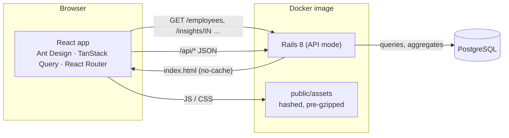

# Architecture

## Overview

There is one deployable unit. Rails serves the JSON API under `/api`, and serves the built React app for every other browser route. The app is a single origin, so it needs no CORS, has one URL, and deploys in one step.

## Backend

| Layer | Responsibility |
|---|---|
| `Employee` model | Validations, input normalisation (trimmed and lower-cased email, collapsed whitespace), currency derived from the country |
| Database constraints | NOT NULL, `salary > 0` and a unique email index. They protect data written by bulk inserts, which skip model validations |
| `Country` | A small value object listing the supported countries and their currencies |
| `EmployeeQuery` | Search (ILIKE with escaped wildcards), exact-match filters, and sorting by whitelisted columns |
| `Pagination` | Limit and offset with safe defaults, capped at 100 per page |
| `PayInsights` | Headcount, min, max, average and median (`PERCENTILE_CONT`) for any scope or group, in one SQL query |
| `OrgOverview` | Pay per country in its own currency, and headcount per department |
| Controllers | Thin. `ApplicationController` turns missing records and missing payloads into JSON 404 and 400 |
| `Seeds::EmployeeSeeder` | Deterministic 10k rows: unique Faker names in each country's locale, inserted with `insert_all` in batches of 1,000 |

## Frontend

| Part | Responsibility |
|---|---|
| `routes.tsx` | Lazy-loaded pages. A spinner shows while the first page chunk loads |
| `features/employees` | `listParams` reads and writes the URL, which is the single source of truth for the list. The table, filters and debounced search sit on top of it. The form modal loads lazily |
| `features/insights` | Overview and country pages, sharing `payColumns` |
| `api/client.ts` | JSON fetch wrapper. Always reads the body, and raises `ApiError` with per-field errors |
| TanStack Query | Caching with a 30s stale time, previous data kept while paging, and the next page prefetched. Saving invalidates employees, filter options and insights together |

## Decisions and trade-offs

| Decision | Why | Cost |
|---|---|---|
| Compare pay within a country only | Pay is set per local market, and converting with exchange rates produces precise-looking numbers that mislead | No org-wide salary total. The UI shows a hint when salaries in different currencies are sorted together |
| Show median next to average | A few high earners skew the average | One extra figure to read |
| Derive currency from country | Every employee is paid in their country's currency, so the two can never disagree | Paying someone in a foreign currency would need a model change |
| URL holds list state | Shareable links, working back/forward, and insights can deep-link into filtered lists | Every filter change creates a history entry |
| Offset pagination | Simple, and supports "jump to page N" | Deep pages are slower (measured 9–12 ms at offset 9,975); keyset pagination is the upgrade path |
| One image for API and UI | One URL, no CORS, one deploy | Frontend and backend release together |
| Runtime CSS-in-JS in production, zero-runtime in tests | Production only generates CSS for the components it uses. Tests skip style generation entirely | Two style modes to know about |
| No authentication in v1 | Single persona and synthetic demo data | Must sit behind SSO before real salaries go in (see requirements) |

## Testing strategy

- **Model specs** cover validations, normalisation and the database constraints, so bulk inserts can't bypass the rules.
- **Query and service specs** (`EmployeeQuery`, `Pagination`, `PayInsights`, `OrgOverview`, the seeder) are fast and deterministic, with fixed data and a fixed random seed.
- **Request specs** cover the public contract: status codes, JSON shapes, errors, and serving the React app.
- **Frontend tests** render whole pages through the real router and query client. Only the HTTP boundary is mocked, with MSW. They assert what a user sees: rows, messages, URLs and the requests sent.
- **Browser verification** (Puppeteer, kept outside the repository) was run for every UI change against both the Vite dev server and a local production build. It took screenshots, checked console errors, failed requests and timings, and compared the numbers in the UI with the API.
